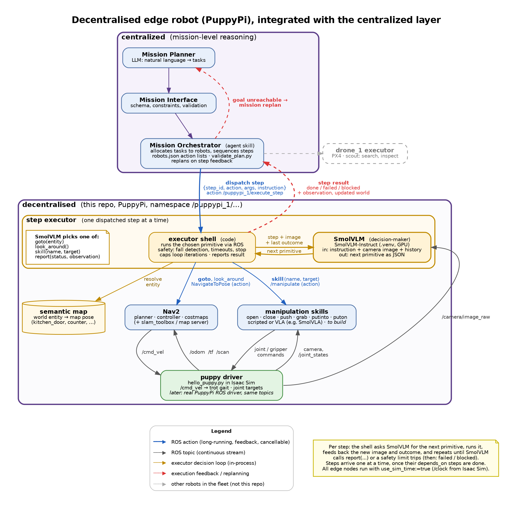

# decentralised

A simulated Hiwonder PuppyPi quadruped in Isaac Sim 6.x, plus a Python environment with the
[SmolVLM](https://huggingface.co/HuggingFaceTB/SmolVLM-Instruct) vision-language model.

## Architecture



This repo is the edge side of the system: it runs on the PuppyPi (`puppypi_1`) and executes steps dispatched by
the Mission Orchestrator in the [centralized](../centralized) layer, reporting each step's result back so the
orchestrator can replan. The diagram is generated from [`docs/architecture.dot`](docs/architecture.dot):

```bash
dot -Tpng -Gdpi=150 docs/architecture.dot -o docs/architecture.png
dot -Tsvg docs/architecture.dot -o docs/architecture.svg
```

So far only the puppy driver (`hello_puppy.py`, without ROS yet) and the SmolVLM download exist; the other nodes are planned.

## Contents

| Path | What it is |
| --- | --- |
| `hello_puppy.py` | Loads the PuppyPi into Isaac Sim and runs a sequence of movements (stand, walk, turn, sit, wave, ...). |
| `puppy_isaac/` | The PuppyPi robot as USD, converted from URDF. Physics lives behind a `Physics` variant (`physx`, `mujoco`, `physics`, `none`). |
| `install.sh` | One-shot setup: Python venv, requirements, SmolVLM weights. |
| `requirements.txt` | Python dependencies for the venv (torch, transformers, accelerate, huggingface_hub, ...). |
| `docs/` | Architecture diagram (`architecture.dot` source, rendered `.png` / `.svg`). |
| `models/` | Downloaded model weights (created by `install.sh`, git-ignored). |

## Setup

```bash
./install.sh
```

This:

1. creates `.venv` and installs `requirements.txt`;
2. downloads `HuggingFaceTB/SmolVLM-Instruct` into `models/SmolVLM-Instruct` (about 4.5 GB; re-running resumes an interrupted download);
3. checks that torch can see the GPU;
4. checks that Isaac Sim is built at `ISAACSIM_PATH`.

Options, passed as environment variables:

| Variable | Default | Purpose |
| --- | --- | --- |
| `PYTHON` | `python3` | Interpreter used to create the venv. |
| `MODEL_ID` | `HuggingFaceTB/SmolVLM-Instruct` | Hugging Face model to download, e.g. `HuggingFaceTB/SmolVLM-500M-Instruct` for a smaller one. |
| `ISAACSIM_PATH` | `~/Projects/isaacsim/_build/linux-x86_64/release` | Isaac Sim release build directory. |
| `HF_HUB_DISABLE_XET` | `1` | Downloads over plain HTTP. Set to `0` to use Hugging Face's Xet transfer instead. |

The model's ONNX exports (`onnx/`, ~25 GB) are skipped, since torch/transformers only need `model.safetensors`.

Isaac Sim itself is not installed by the script: build Isaac Sim 6.x from source and point `ISAACSIM_PATH` at its
release directory.

## Running the simulation

Use Isaac Sim's own Python, not the venv:

```bash
~/Projects/isaacsim/_build/linux-x86_64/release/python.sh hello_puppy.py --keep-open
```

| Flag | Effect |
| --- | --- |
| `--moves MOVE ...` | Movements to run, in order (default: stand, walk_forward, turn_left, walk_backward, turn_right, sit, stand, wave, lie_down). |
| `--keep-open` | Keep the window open after the movements finish. |
| `--headless` | Run without a window. |
| `--check` | First run sanity checks: one articulation root, falls under gravity and lands on the ground, joints track targets. |
| `--usd PATH` | Use a different robot USD (default: `puppy_isaac/puppy_isaac.usda`). |

Available movements: `stand`, `sit`, `lie_down`, `bow`, `push_up`, `nod`, `wave`, `march`, `walk_forward`,
`walk_backward`, `turn_left`, `turn_right`.

```bash
python.sh hello_puppy.py --moves stand walk_forward turn_left sit --keep-open
```

Each movement is a function in `hello_puppy.py` that describes foot positions; the `Puppy` class turns those into
hip/knee joint targets with two-link inverse kinematics, and walking/turning use a diagonal trot gait.

## Using SmolVLM

```bash
source .venv/bin/activate
```

```python
from transformers import AutoProcessor, AutoModelForVision2Seq

processor = AutoProcessor.from_pretrained("models/SmolVLM-Instruct")
model = AutoModelForVision2Seq.from_pretrained("models/SmolVLM-Instruct", torch_dtype="auto", device_map="auto")
```
