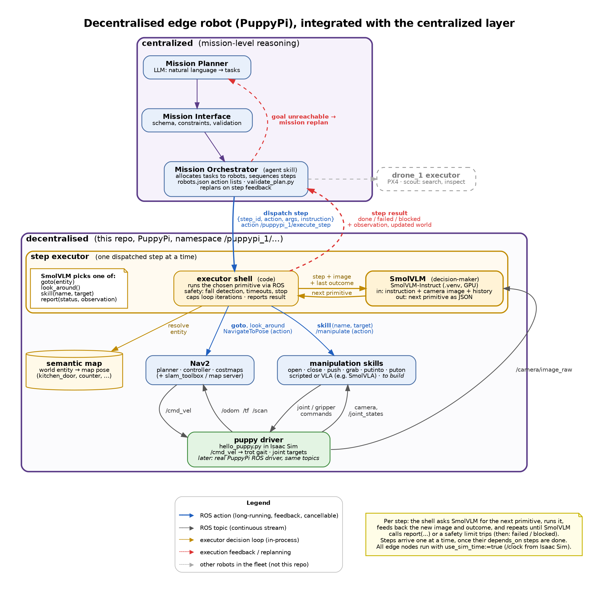

# decentralised

A simulated Hiwonder PuppyPi quadruped in Isaac Sim 6.x, plus a Python environment with the
[SmolVLM](https://huggingface.co/HuggingFaceTB/SmolVLM-Instruct) vision-language model.

> **System documentation (source of truth for both repos)** lives in the centralized repo:
> [Architecture](https://github.com/Thesis-Physical-AI/centralized/blob/main/docs/SYSTEM_ARCHITECTURE.md) ·
> [Interface contracts](https://github.com/Thesis-Physical-AI/centralized/blob/main/docs/INTERFACE_CONTRACTS.md) ·
> [Open decisions](https://github.com/Thesis-Physical-AI/centralized/blob/main/docs/DECISIONS.md) ·
> [Roadmap](https://github.com/Thesis-Physical-AI/centralized/blob/main/docs/ROADMAP.md).

## Architecture (target design)



This repo is the edge side of the system. It targets the PuppyPi (`puppypi_1`): it will execute steps dispatched by
the Mission Orchestrator in the [centralized](../centralized) layer and report each step's result back so the
orchestrator can replan. **Today it runs only in Isaac Sim on the workstation**; the diagram shows the target
design, not the current state. It is generated from [`docs/architecture.dot`](docs/architecture.dot):

```bash
dot -Tpng -Gdpi=150 docs/architecture.dot -o docs/architecture.png
dot -Tsvg docs/architecture.dot -o docs/architecture.svg
```

So far: the puppy driver (`hello_puppy.py`, without ROS yet) and an experimental step-executor prototype in which the
VLM answers closed visual questions and can choose navigation goals, running under an emulated Raspberry Pi 5 profile
([`docs/ONBOARD_VLM.md`](docs/ONBOARD_VLM.md)). ROS 2 and Nav2 are planned.

## Contents

| Path | What it is |
| --- | --- |
| `hello_puppy.py` | Loads the PuppyPi into Isaac Sim and runs a sequence of movements (stand, walk, turn, sit, wave, ...). |
| `run_prototype.py` | **Experimental:** runs mission steps through the step executor in Isaac Sim, with SmolVLM or ground-truth perception. Calibrated VLM thresholds per model are in `THRESHOLDS`. |
| `puppy_agent/` | Step executor, Nav2-shaped navigation interface, perception interface, gait and IK. Plain Python, unit-tested. |
| `sim/` | Isaac Sim driver for the prototype (velocity-driven gait, front camera) and world files. |
| `vlm_server/` | SmolVLM perception server over local HTTP, under an onboard-computer profile: single closed questions (visible? left/center/right? near?), and `/ask` for a whole question set about one frame of the live camera feed (open answers in words plus scored ones). Live view at `/view`. Onboard-computer profiles (workstation GPU, emulated Raspberry Pi 5) are in `PROFILES` in `smolvlm_server.py`. |
| `missions/` | Example mission steps in contract v0.1 form. |
| `tests/unit/` | GPU-free tests: `python -m pytest -q tests/unit`. |
| `puppy_isaac/` | The PuppyPi robot as USD, converted from URDF. Physics lives behind a `Physics` variant (`physx`, `mujoco`, `physics`, `none`). |
| `install.sh` | One-shot setup: Python venv, requirements, SmolVLM weights. |
| `requirements.txt` | Pinned Python dependencies for the VLM venv (torch, transformers, accelerate, huggingface_hub, ...). |
| `docs/` | Architecture diagram (`architecture.dot` source, rendered `.png` / `.svg`), prototype and onboard-VLM notes. |
| `models/` | Downloaded model weights (created by `install.sh`, git-ignored). |

## Setup

```bash
./install.sh
```

This:

1. creates `.venv` and installs `requirements.txt`;
2. downloads `HuggingFaceTB/SmolVLM-Instruct` into `models/SmolVLM-Instruct` (about 4.5 GB; re-running resumes an interrupted download);
3. checks that torch can see the GPU;
4. checks that Isaac Sim is built at `ISAACSIM_PATH`.

Options, passed as environment variables:

| Variable | Default | Purpose |
| --- | --- | --- |
| `PYTHON` | `python3` | Interpreter used to create the venv. |
| `MODEL_ID` | `HuggingFaceTB/SmolVLM-Instruct` | Hugging Face model to download. For onboard (Raspberry Pi 5) use, `HuggingFaceTB/SmolVLM-500M-Instruct` is recommended ([`docs/ONBOARD_VLM.md`](docs/ONBOARD_VLM.md)). |
| `ISAACSIM_PATH` | `~/Projects/isaacsim/_build/linux-x86_64/release` | Isaac Sim release build directory. |
| `HF_HUB_DISABLE_XET` | `1` | Downloads over plain HTTP. Set to `0` to use Hugging Face's Xet transfer instead. |

The model's ONNX exports (`onnx/`, ~25 GB) are skipped, since torch/transformers only need `model.safetensors`.

Isaac Sim itself is not installed by the script: build Isaac Sim 6.x from source and point `ISAACSIM_PATH` at its
release directory. The paths below assume `~/Projects/isaacsim`; replace them with your `$ISAACSIM_PATH`.
Don't move a source build after building it: it contains absolute symlinks and `python.sh` then fails with
`No module named 'isaacsim'`.

The SmolVLM download is only needed for VLM experiments, not for the simulation.

## Running the simulation

Use Isaac Sim's own Python, not the venv:

```bash
~/Projects/isaacsim/_build/linux-x86_64/release/python.sh hello_puppy.py --keep-open
```

| Flag | Effect |
| --- | --- |
| `--moves MOVE ...` | Movements to run, in order (default: stand, walk_forward, turn_left, walk_backward, turn_right, sit, stand, wave, lie_down). |
| `--keep-open` | Keep the window open after the movements finish. |
| `--headless` | Run without a window. |
| `--check` | First run sanity checks: one articulation root, falls under gravity and lands on the ground, joints track targets. |
| `--usd PATH` | Use a different robot USD (default: `puppy_isaac/puppy_isaac.usda`). |

Available movements: `stand`, `sit`, `lie_down`, `bow`, `push_up`, `nod`, `wave`, `march`, `walk_forward`,
`walk_backward`, `turn_left`, `turn_right`.

```bash
python.sh hello_puppy.py --moves stand walk_forward turn_left sit --keep-open
```

Each movement is a function in `hello_puppy.py` that describes foot positions; the `Puppy` class turns those into
hip/knee joint targets with two-link inverse kinematics, and walking/turning use a diagonal trot gait.

## Using SmolVLM

```bash
source .venv/bin/activate
```

```python
from transformers import AutoProcessor, AutoModelForImageTextToText

processor = AutoProcessor.from_pretrained("models/SmolVLM-Instruct")
model = AutoModelForImageTextToText.from_pretrained("models/SmolVLM-Instruct", dtype="auto", device_map="auto")
```
